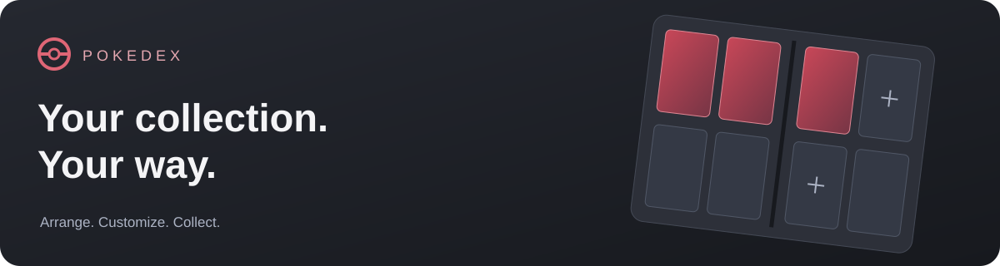
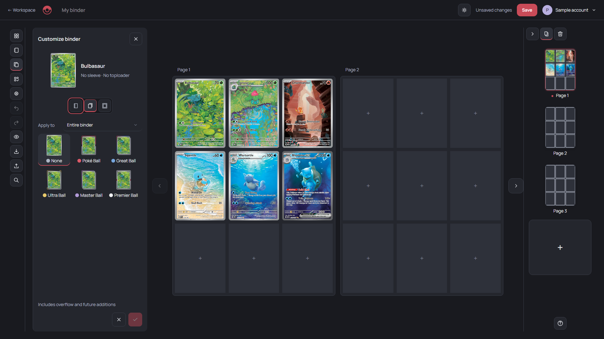

<div align="center">



**A Pokémon binder workshop built around your cards.**

Arrange your collection, customize every detail, and make a binder that feels like yours.

[](docs/FRONTEND-MVP.md)


[**Open the website ↗**](https://esterit.github.io/Pokedex/) &nbsp; · &nbsp; [Documentation](docs/README.md) &nbsp; · &nbsp; [MVP milestone](https://github.com/EsteriT/Pokedex/tree/frontend-mvp-2026-10-16)

</div>

---



### A place for every card

| | What you can do |
| :--- | :--- |
| **Build your binder** | Arrange cards in one or two page views. Add, reorder and resize pages; merge connected pockets. |
| **Move things naturally** | Drag cards to swap pockets, push a row toward an empty space, or keep displaced cards in Overflow. Select batches and copy cards between binders. |
| **Make it yours** | Choose covers, including transparent; add titles and artwork; style cards with sleeves and toploaders. |
| **Find what fits** | Explore the sample catalogue through search, filters and curated color matching. Track your collection in Workspace. |
| **Keep your work** | Save, download a backup, and restore it later. Open a read-only view of your saved binder. |

### Before you begin

This is the **frontend MVP**, accepted on October 16, 2026. It includes **55 sample card printings**; prices are fictional interface examples.

The hosted cloud beta adds **Google sign-in, private binders and account collections**. Use **Save** to keep edits and **Download backup** for a portable copy. Existing browser binders and collection records are imported explicitly, preserving their browser originals. Unconfigured builds keep the original local prototype. Actual hosted login/Save acceptance is tracked in the [rollout record](docs/HOSTED-ROLLOUT.md).

### Run locally

Requires Node.js 22+ and a local web server. Install the pinned dependencies before building.

```sh
git clone https://github.com/EsteriT/Pokedex.git
cd Pokedex
npm ci
npm run build
python -m http.server 5500
```

Open **[localhost:5500/src/](http://localhost:5500/src/)**. You can also use VS Code Live Server on `src/index.html`, or open the generated `preview/Pokedex-landing-page.html`. Card images require an internet connection.

The audited binder backend foundation and hosted database are deployed. Google provider settings are configured, and the Pages workflow supplies the public backend configuration. Unconfigured builds keep browser-local saving. See the [backend foundation guide](docs/BACKEND-FOUNDATION.md) and [hosted rollout](docs/HOSTED-ROLLOUT.md) for setup, verified acceptance and beta limits.

Account collection storage is implemented and tested on `feat/collection-cloud`; its approved hosted migration and website update are now live. See [the collection guide](docs/COLLECTION-CLOUD.md) for private saving, browser import, conflict recovery and test coverage. Actual hosted collection UI acceptance remains pending.

### Develop & verify

Edit the files in `src/`; generated previews are rebuilt from those sources.

| Command | Purpose |
| :--- | :--- |
| `npm run build` | Rebuild the five standalone previews. |
| `npm run check` | Validate references, JavaScript, assets and preview links. |
| `npm test` | Check binder, collection, catalogue and customization behavior. |
| `npm run build:pages` | Build the deployment into `dist/` and check its page links. |
| `npm run test:browser` | Run Chromium regressions with Python 3 and Brave, Chrome or Edge. Set `BROWSER_PATH` if needed. |
| `npm run test:backend` | Execute database rules in embedded PostgreSQL. |
| `npm run test:repository` | Check the cloud adapter with controlled SDK fixtures. |
| `npm run test:backend:live` | Test real services against a running local Supabase stack only. |
| `npm run test:backend:browser` | Check real local cloud Save, backups, conflicts, sign-out and account isolation in Chromium. |

```text
src/        Editable pages, styles, scripts and sample data
assets/     Fonts, artwork and their attribution
preview/    Generated standalone versions of the five pages
scripts/    Build scripts and regression checks
docs/       Design decisions, architecture and project records
```

### Project notes

- [Frontend MVP](docs/FRONTEND-MVP.md) — accepted scope and compatibility limits.
- [Deployment](docs/DEPLOYMENT.md) — GitHub Pages setup and publishing.
- [Design](docs/DESIGN.md) · [Architecture](docs/ARCHITECTURE.md) · [Current handoff](docs/HANDOFF.md).

Desktop and phone-size layouts have been checked in Chromium browsers. Physical mobile devices, Safari and Firefox still need manual verification. Live catalogue/pricing, automatic realtime synchronization, public sharing and print/image export remain future work.

---

<sub>Independent fan project. Pokémon and related artwork belong to their respective owners; this project is not affiliated with or endorsed by them. See [artwork credits](assets/credits/pokemon-cover-art.txt) and the [Manrope font license](assets/manrope-OFL.txt). No project-wide software license has been selected.</sub>
